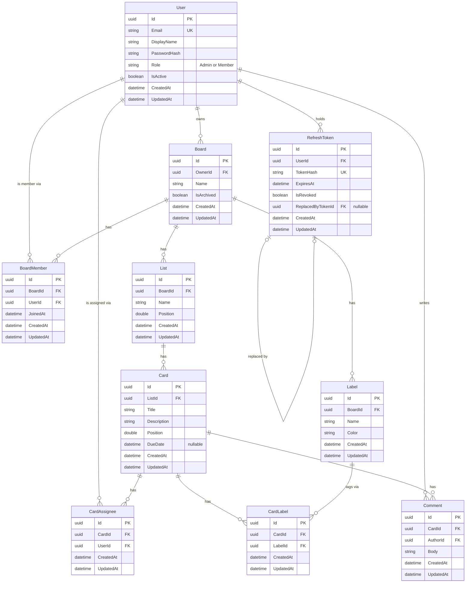

# Database schema (ERD)

Source of truth for the Stack Track data model. Feature tickets, EF Core configuration and migrations follow this document. Database: PostgreSQL.

## Conventions

- Primary keys are GUIDs (`uuid`), column `Id`, generated by the application.
- Every table has `CreatedAt` and `UpdatedAt` (`timestamptz`, UTC). `UpdatedAt` is set on every write.
- Join tables (`BoardMember`, `CardAssignee`, `CardLabel`) also have their own GUID `Id`, so the two rules above hold for every table. The pair of foreign keys is made unique instead (see [Unique constraints](#unique-constraints)).
- Foreign key columns are named `<Entity>Id` (`OwnerId`, `AuthorId`, `ReplacedByTokenId` where the role matters).

## Diagram

## Relationships and delete behavior

Every foreign key is `NOT NULL` except `RefreshToken.ReplacedByTokenId`. "On delete" is what happens to the child rows when the parent row is deleted.

| Relationship | Cardinality | On delete of parent |
|---|---|---|
| User -> Board (owner) | 1:N | RESTRICT |
| Board -> BoardMember | 1:N | CASCADE |
| User -> BoardMember | 1:N | RESTRICT |
| Board -> List | 1:N | CASCADE |
| List -> Card | 1:N | CASCADE |
| Board -> Label | 1:N | CASCADE |
| Card -> CardAssignee | 1:N | CASCADE |
| User -> CardAssignee | 1:N | RESTRICT |
| Card -> CardLabel | 1:N | CASCADE |
| Label -> CardLabel | 1:N | CASCADE |
| Card -> Comment | 1:N | CASCADE |
| User -> Comment (author) | 1:N | RESTRICT |
| User -> RefreshToken | 1:N | RESTRICT |
| RefreshToken -> RefreshToken (replaced by) | 1:0..1 | SET NULL |

### Deleting a board

Deleting a board removes its lists, cards, labels, comments and memberships in one statement, via the cascades above:

- its lists, and through them their cards, and through those the cards' comments, assignees and label links
- its labels
- its memberships

No cascade targets `User`. Every foreign key that points at `User` is RESTRICT, so deleting a board can never delete users.

### Users are never deleted

Deleting a user is not supported. A user who leaves is deactivated (`User.IsActive = false`): they cannot sign in and their refresh tokens are revoked, but their boards, comments and assignments stay intact. The RESTRICT on every `User` foreign key makes an accidental delete fail instead of silently losing history.

## Unique constraints

| Constraint | Columns | Rule |
|---|---|---|
| User email | `User.Email` | Unique. Stored lowercased, so uniqueness is case-insensitive. |
| One membership per user per board | `BoardMember (BoardId, UserId)` | Unique pair. |
| Label name per board | `Label (BoardId, lower(Name))` | Unique per board, case-insensitive. Two boards may reuse a name. |
| One assignment per user per card | `CardAssignee (CardId, UserId)` | Unique pair. |
| Card label | `CardLabel (CardId, LabelId)` | Unique pair, a label is applied to a card once. |
| Refresh token | `RefreshToken.TokenHash` | Unique. Only the hash is stored, never the token. |

## Rules enforced in the application, not the database

- A card assignee must be a member of the card's board.
- A card's label must belong to the card's board.
- The board owner is added as a `BoardMember` when the board is created.

## Ordering of lists and cards

`List.Position` (within a board) and `Card.Position` (within a list) are `double precision` numbers. Items are shown in ascending `Position` order. The value only has to sort correctly; it carries no other meaning. Index `(ListId, Position)` and `(BoardId, Position)` are non-unique, so a half-finished move never violates a constraint.

Moving an item changes one row: only the moved item gets a new `Position`, computed from its new neighbours. Nothing else in the list is rewritten.

| Insert at | New `Position` |
|---|---|
| Empty list | `1000` |
| End | last `Position` + `1000` |
| Start | first `Position` / 2 |
| Between A and B | (A + B) / 2 |

Moving a card to another list also sets `ListId`, still one row.

### Example: move a card between two others

A list holds three cards: A = 1000, B = 2000, C = 3000. Order is A, B, C. Move C between A and B:

1. Neighbours of the target slot are A (1000) and B (2000).
2. New position of C = (1000 + 2000) / 2 = 1500.
3. `UPDATE Card SET ListId = <same>, Position = 1500 WHERE Id = <C>`. A and B keep 1000 and 2000.

Order is now A (1000), C (1500), B (2000).

### Rebalancing

Repeated inserts into the same gap halve it each time. When the gap between the two neighbours falls below `0.000001` (about 30 inserts into one gap), the API renumbers that one list to 1000, 2000, 3000, ... in a single transaction, then performs the insert. This is rare and touches one list only.
