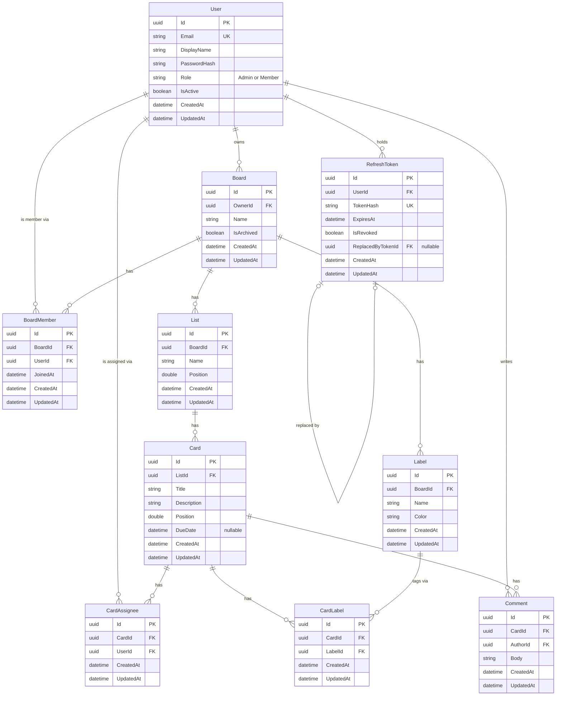

# Database schema (ERD)

Source of truth for the Stack Track data model. Feature tickets, EF Core configuration and migrations follow this document. Database: PostgreSQL.

## Conventions

- Primary keys are GUIDs (`uuid`), column `Id`, generated by the application.
- Every table has `CreatedAt` and `UpdatedAt` (`timestamptz`, UTC). `UpdatedAt` is set on every write.
- Join tables (`BoardMember`, `CardAssignee`, `CardLabel`) also have their own GUID `Id`, so the two rules above hold for every table. The pair of foreign keys is made unique instead (see [Unique constraints](#unique-constraints)).
- Foreign key columns are named `<Entity>Id` (`OwnerId`, `AuthorId`, `ReplacedByTokenId` where the role matters).

## Diagram

